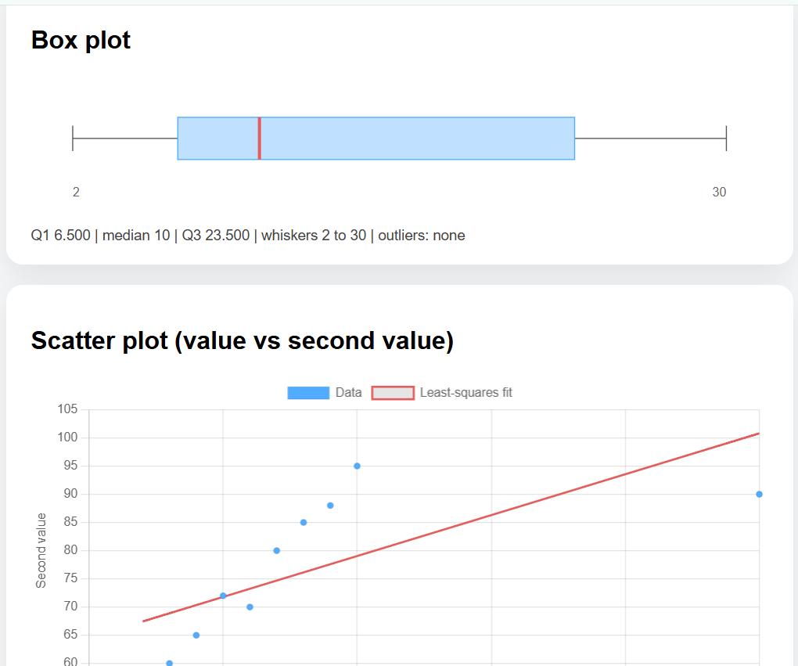

# CSV Analytics Dashboard (Spring Boot + MySQL)

Upload a CSV and get descriptive statistics and charts back, with a built-in
timing panel that shows where the time goes.

## Key finding
Uploading a 50,000-row CSV took 31.52 s end to end. About 29.5 s of that
(roughly 94%) was the MySQL save, so database writes are the bottleneck.
Batch inserts are the fix. [Add the before/after numbers once you've
implemented it.]

## Features
- CSV upload and storage in MySQL via Spring Data JPA
- Histogram endpoint and Chart.js charts
- Timing panel measuring upload-to-chart time
- [Only list features that are working today]

## Tech stack
Java 21, Spring Boot (Spring Web, Spring Data JPA), Maven, MySQL, Chart.js

## Performance results
Measured locally on [your machine specs]:

| Rows   | Total time (s) | Notes                    |
|--------|----------------|--------------------------|
| 1,000  | 0.69           |                          |
| 10,000 | 4.27           |                          |
| 50,000 | 31.52          | MySQL save: about 29.5 s |

## How it works
1. CSV is uploaded through the dashboard
2. Rows are saved to MySQL through JPA
3. Statistics are computed and sent to Chart.js
4. The timing panel records each stage

## Run locally
1. Install JDK 21, Maven, and MySQL
2. Create a database: `CREATE DATABASE [your_db_name];`
3. Copy `application.properties.example` to `application.properties` and
   set your own MySQL URL, username, and password
4. `mvn spring-boot:run`
5. Open `http://localhost:8080/chart.html`

## Limitations
- Timings come from one local machine, not a controlled benchmark
- [Anything else you know is rough or unfinished]

## Roadmap
- [ ] Batch inserts (the proposed fix for the 94% bottleneck)
- [ ] Box plot and scatter plot
- [ ] More statistics: skewness, confidence interval, correlation
- [ ] CSV export
